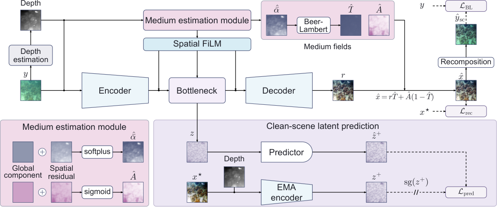

# SmoothAlpha

**SmoothAlpha: A Unified Physics-Conditioned Latent-Predictive Framework for Low-Visibility Image Restoration**

Tianchi Xu, Yuanpeng He, Yuanzheng Huang, Yuanjia Wei, Wenpin Jiao, and Zhi Jin

One restoration model handles underwater, fog, and smoke images without a test-time medium label. A smooth effective extinction field provides spatial FiLM conditioning and Beer–Lambert composition. Clean-scene EMA prediction and normalized conflict projection operate during training.



[Architecture PDF](figures/architecture.pdf) · [Editable SVG](figures/architecture.svg)

## Installation

Use Python 3.11. The restoration implementation uses PyTorch 2.5.1 and torchvision 0.20.1. Select the matching CUDA wheels using the [official PyTorch instructions](https://pytorch.org/get-started/previous-versions/) when training on an NVIDIA GPU.

```bash
python -m venv .venv
source .venv/bin/activate
python -m pip install -r requirements.txt
python scripts/check_installation.py
```

The installation check runs on CPU without pretrained weights or benchmark downloads. It checks the model, fixed partitions, sampling budget, and metric definitions. LPIPS and the depth extractor download their pretrained feature weights on first use.

## Model and geometry files

Use the project's [Releases page](https://github.com/TianchiXu1/SmoothAlpha/releases) for model and geometry attachments. The source tree and these large assets are distributed separately.

| File | Contents and use |
| --- | --- |
| `smooth_alpha_joint_seed42.pth` | Trained restoration checkpoint. Place it at `pretrained/smooth_alpha_joint_seed42.pth`. |
| `SmoothAlpha_Water_Test_Pairs.zip` | All 89 underwater test pairs, including degraded RGB and clean references. |
| `SmoothAlpha_Fog_Test_Pairs.zip` | All 128 fog test pairs, including degraded RGB and clean references. |
| `SmoothAlpha_Smoke_Test_Pairs.zip` | All 50 smoke test pairs, including degraded RGB and clean references. |
| `SmoothAlpha_Test_Depth_Cache.zip` | Corrected degraded-input depth maps: 89 water, 128 fog, and 50 smoke test images. Organized as `<medium>/depth/<filename>.npy`; use `infer.py --depth_dir <medium>/depth`. |

The geometry archive contains the author-confirmed degraded-input depth arrays, test filename lists, and per-domain `depth_metadata.json` files (267 depth maps in total). These metadata files were reconstructed for the supplied cache and record that limitation explicitly. Extract the archive into `SmoothAlpha_Test_Benchmark/`, alongside the matching `raw/` and `reference/` images, to use the default test command.

## Download and run the published test set

After installation, download the public test pairs, depth cache, and checkpoint:

```bash
mkdir -p release_assets pretrained SmoothAlpha_Test_Benchmark
release=https://github.com/TianchiXu1/SmoothAlpha/releases/download/v1.0.0
for domain in Water Fog Smoke; do
  curl -fL "$release/SmoothAlpha_${domain}_Test_Pairs.zip" \
    -o "release_assets/SmoothAlpha_${domain}_Test_Pairs.zip"
  unzip -q "release_assets/SmoothAlpha_${domain}_Test_Pairs.zip"
done
curl -fL "$release/SmoothAlpha_Test_Depth_Cache.zip" \
  -o release_assets/SmoothAlpha_Test_Depth_Cache.zip
unzip -q release_assets/SmoothAlpha_Test_Depth_Cache.zip -d SmoothAlpha_Test_Benchmark
curl -fL "$release/smooth_alpha_joint_seed42.pth" \
  -o pretrained/smooth_alpha_joint_seed42.pth
python test.py --checkpoint pretrained/smooth_alpha_joint_seed42.pth \
  --data_root ./SmoothAlpha_Test_Benchmark \
  --output results/seed42 --device cpu --save_images
```

These are public download links; no GitHub account is required. Use `--device cuda:0` for a CUDA GPU. The public archives contain all 267 test pairs; training and validation images are obtained separately. Compare this checkpoint with the single-checkpoint column below.

## Inference

Place a trained restoration checkpoint at `pretrained/smooth_alpha_joint_seed42.pth`, then restore RGB images without clean references:

```bash
python infer.py --checkpoint pretrained/smooth_alpha_joint_seed42.pth \
  --input_dir images --output_dir results/restored --device cuda:0
```

The command extracts frozen Depth-Anything-v2-Small geometry from each degraded input and writes restored RGB PNGs at the paper's 256 × 256 resolution. Its first run downloads the depth estimator. Use `--device cpu` when CUDA is unavailable. The output directory must be empty, and input filenames must have distinct stems.

To reuse matching degraded-input depth maps, add `--depth_dir depth_cache`, with one finite 2D `filename.npy` per input image. Each map is normalized per image before resizing. Add `--save_fields` to also write `fields/filename.npz` containing the raw `alpha`, `T`, and `veil` arrays in height × width × RGB order. These fields use the normalized geometry scale described in the paper.

## Data

Use this layout for each medium. The filenames in `data/splits/` define the exact paper partitions; the loader reads those lists directly.

```text
SmoothAlpha_Test_Benchmark/
├── water/
│   ├── raw/
│   ├── reference/
│   ├── depth/
│   └── depth_metadata.json
├── fog/
│   ├── raw/
│   ├── reference/
│   ├── depth/
│   └── depth_metadata.json
└── smoke/
    ├── raw/
    ├── reference/
    ├── depth/
    └── depth_metadata.json
```

For example, `water/raw/0363.png` pairs with `water/reference/0363.png` and `water/depth/0363.npy`. RGB inputs are resized to 256 × 256 with PIL bilinear interpolation. Each finite 2D depth array is normalized per image to [0, 1], then bilinearly resampled to 256 × 256. Missing depth files stop execution.

| Medium | Dataset | Train | Validation | Test | Split file |
| --- | --- | ---: | ---: | ---: | --- |
| Water | UIEB | 712 | 89 | 89 | `uieb_split.json` |
| Fog | Multi-view fog from DTU | 467 | 64 | 128 | `dtu_fog_split.json` |
| Smoke | Mitsuba bunny and dragon | 200 | 50 | 50 | `mitsuba_smoke_split.json` |

Obtain the original UIEB images from the [UIEB project](https://li-chongyi.github.io/proj_benchmark.html). `data/splits/uieb_source_filenames.json` maps the released numeric filenames to the source image names. The fog pairs are the paper's synthesized DTU benchmark, and the smoke pairs are the paper's Mitsuba renders; the original [DTU data](https://roboimagedata.compute.dtu.dk/) and [Mitsuba renderer](https://www.mitsuba-renderer.org/) alone do not contain these paired benchmark images.

The three test-pair archives above provide the exact published test filenames for all domains. Training and validation pairs are separate dataset assets. A checkpoint produced by `train.py` can also be evaluated with the command below.

## Input-depth preparation

Depth is extracted from the degraded `raw/` RGB images during both training and evaluation. The frozen [Depth-Anything-v2-Small](https://huggingface.co/depth-anything/Depth-Anything-V2-Small-hf) estimator produces the cue; clean references supervise image restoration and the training-only EMA target.

```bash
python scripts/extract_depth_anything_v2.py \
  --data_root ./SmoothAlpha_Test_Benchmark --device cuda:0
```

For a test-only archive, add `--splits test`. The extractor writes one normalized `.npy` per image and `depth_metadata.json`. A complete matching cache can be reused. The loader requires its extraction record and never substitutes constant depth for a missing array.

## Training

```bash
python train.py --config configs/smooth_alpha_joint.yaml \
  --data_root ./SmoothAlpha_Test_Benchmark \
  --output runs/smooth_alpha_joint_seed42 --device cuda:0
```

The configuration implements 50 epochs, 2,136 draws per epoch, exactly 712 draws per medium per epoch, batch size 8, and AdamW with learning rate 2e-4, weight decay 1e-4, and cosine decay to 1e-6. This gives 35,600 draws per medium and 106,800 overall. Medium gradients are separated within each mixed batch, normalized by their EMA magnitude, projected when conflicting, and combined before one optimizer update. The sampler and projection order use the configured seed.

The objective uses L1 reconstruction (1.2), MS-SSIM (0.7), stopped-gradient observation consistency (0.1), low-resolution extinction TV (0.01), and extinction amplitude, veiling TV, and output TV (0.001 each). Latent prediction has weight 0 for epochs 1–5 and 0.1 thereafter. LPIPS has weight 0 before epoch 20 and ramps from 0.1 to 0.5 over epochs 20–24. The EMA momentum follows a cosine schedule from 0.996 to 1.0.

Selection uses the mean of the three validation PSNRs every five epochs. The selected inference checkpoint is written as `runs/smooth_alpha_joint_seed42/smooth_alpha_joint_seed42.pth`. The predictor and EMA target are excluded from the distributed checkpoint. To run seeds 43 and 44, pass `--seed 43` or `--seed 44` and use a separate output directory.

## Evaluation

Place the selected checkpoint at `pretrained/smooth_alpha_joint_seed42.pth`, then run:

```bash
python test.py --checkpoint pretrained/smooth_alpha_joint_seed42.pth \
  --data_root ./SmoothAlpha_Test_Benchmark \
  --output results/seed42 --device cuda:0 --save_images
```

Evaluation strictly loads the restoration parameters and scores every listed test pair. It writes per-image CSVs, aggregate metrics, and optionally restored PNGs. PSNR and channel-averaged SSIM use floating-point RGB in [0, 1]; LPIPS uses AlexNet features on RGB scaled to [-1, 1]. UIQM and UCIQE use the quantized restored RGB. `sift_keypoints` reports detected keypoints, as used for the paper's structural contrast indicator; `sift_matches` separately reports reference matches using a 0.75 nearest-neighbor ratio test. A metric's `image_std` measures variation across images, not across training seeds. The three-domain PSNR is an unweighted mean of the three domain means.

## Results reported in the paper

| Domain | Main Benchmark (Table II, 3-run mean ± std) | Released Checkpoint (`smooth_alpha_joint_seed42.pth`, Table V) | SSIM | LPIPS | SIFT | Params (M) |
| --- | ---: | ---: | ---: | ---: | ---: | ---: |
| Underwater (UIEB) | 23.45 ± 0.14 dB | 23.46 dB | 0.907 | 0.100 | 743.3 | 7.9 |
| Fog (Multiview) | 27.98 ± 0.78 dB | 28.31 dB | 0.927 | 0.052 | 194.0 | 7.9 |
| Smoke (Mitsuba) | 47.41 ± 0.56 dB | 47.39 dB | 0.9970 | 0.0052 | 6.9 | 7.9 |
| **Three-Domain Mean** | **32.95 dB** | **33.05 dB** | **0.944** | **0.052** | — | **7.9** |

The deployed restoration network contains 7,905,624 parameters (excluding the frozen 24,785,089-parameter Depth-Anything-v2 ViT-S estimator).

## Repository

```text
configs/     Joint training configuration
models/      Restoration model, losses, and training-only latent prediction
data/        Paired loader, exact exposure sampler, and fixed split lists
scripts/     Input-depth extraction and installation checks
figures/     Architecture figure
train.py     Joint training
test.py      Paired evaluation
infer.py     RGB directory restoration without clean references
metrics.py   Paired, underwater, and structural metrics
```

## Citation

Please cite the paper title and authors above when using SmoothAlpha. Citation metadata is provided in [CITATION.cff](CITATION.cff). Original source code uses the [MIT license](LICENSE); third-party datasets and pretrained feature models retain their original licenses. See [CONTRIBUTING.md](CONTRIBUTING.md) for development and issue-reporting guidance.
